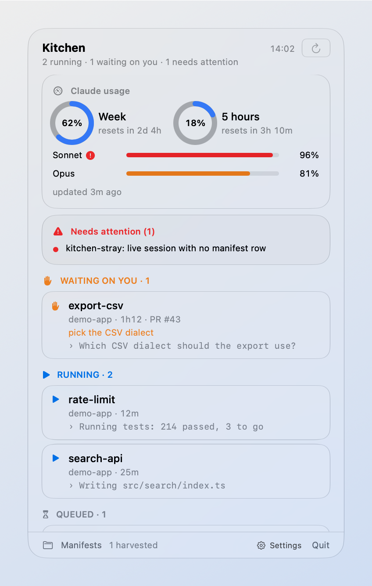
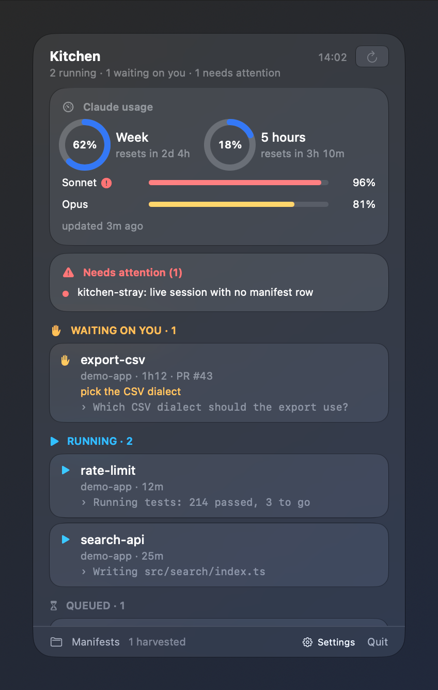

# Native menu-bar app (macOS 26+)

`macos/` holds **Kitchen.app**, a small SwiftUI menu-bar app. Click its icon and a Liquid
Glass panel opens with everything the [SwiftBar plugin](menubar.md) shows — units by state,
what each agent is doing, divergences — plus **how much of your Claude plan you have used**
this week and in the current five-hour window.

The SwiftBar plugin stays: it is the lighter alternative, and it is also the app's **data
source**. The app never parses a manifest or talks to tmux itself; it runs
`kitchen.30s.py --json` and draws the result.

This page is the design plan the app was built from: what it reads, how it is laid out,
every state it can be in, the visual tokens, accessibility, and the decisions with their
reasons.

## Screenshots

Rendered from fixtures (`Kitchen --demo`), never from a real kitchen.

| light | dark |
|---|---|
|  |  |

## Install

Requirements: **macOS 26 or newer**, Xcode 26+ (or its Command Line Tools with Swift 6.2+),
`python3`, `tmux`. No Xcode GUI is needed.

```bash
make -C macos app        # builds macos/build/Kitchen.app (release, ad-hoc signed)
make -C macos install    # copies it to ~/Applications
open ~/Applications/Kitchen.app
make -C macos test       # swift test
```

The app reads the same config as the plugin, `~/.config/kitchen-menubar/config.json` (see
[menubar.md](menubar.md#configuration)) — at minimum set `manifests`. To start it at login,
add `~/Applications/Kitchen.app` in *System Settings → General → Login Items*.

## Architecture

```text
 ┌──────────── Kitchen.app (SwiftUI, LSUIElement) ────────────┐
 │                                                            │
 │  MenuBarExtra(.window) ── PanelView ◄── AppModel (@MainActor)
 │                                          │         │       │
 │                     every 30 s (pref.)   │         │ ≥ 5 min, backoff
 │                                          ▼         ▼       │
 │                              KitchenSource    UsageSource  │
 └──────────────────────────────────┼───────────────┼─────────┘
                                    │               │
        python3 Resources/kitchen.py --json         │ /usr/bin/security find-generic-password
        (timeout 10 s; same config file)            │   -s "Claude Code-credentials" -w   (read only)
                                    │               │ GET https://api.anthropic.com/api/oauth/usage
                         manifests + tmux           │   (ephemeral session, redirects refused)
```

Swift package `macos/Package.swift`, three targets so the logic is testable without a UI:

| target | what it holds | depends on |
|---|---|---|
| `KitchenCore` | the `--json` model and decoder, the usage model and decoder, the pure state reducers that decide what the panel and the usage card show (every state in the table below), "resets in" formatting, severity thresholds, the poll/backoff policy, the process runner, the credential reader, the usage request | Foundation |
| `KitchenUI` | design tokens, every view, the menu-bar label, `AppModel`, fixtures for previews/demo | `KitchenCore`, SwiftUI |
| `Kitchen` | the `@main` app: the `MenuBarExtra` scene and the `--demo` window | `KitchenUI` |

`make app` builds the release binary with SwiftPM and assembles the bundle by script:
`Contents/MacOS/Kitchen`, `Contents/Info.plist` (`LSUIElement = true`, minimum system
version 26.0) and `Contents/Resources/kitchen.py` — a **copy of `menubar/kitchen.30s.py`**
made at build time, so there is one source of truth for the parsing. Then `codesign --sign -`
(ad hoc). The app is not sandboxed: it has to run `python3`, `tmux` (through the script) and
`/usr/bin/security`.

### Kitchen data: `kitchen.30s.py --json`

The plugin gained a `--json` mode that runs the same pipeline as the menu (config → manifests
→ tmux → model → last screen line per live unit) and prints one JSON object instead of
SwiftBar lines. Schema version 1:

```json
{
  "schema": 1,
  "generated_at": 1767225600.0,
  "warning": null,
  "error": null,
  "tmux_reason": "",
  "globs": 2,
  "manifest_dir": "/path/to/plans",
  "counts": {"running": 1, "waiting": 1, "queued": 1, "done": 1, "aborted": 1, "harvested": 0, "unknown": 0},
  "units": [
    {"unit": "rate-limit", "project": "demo-app", "status": "running", "reason": "",
     "size": "M", "route": "kitchen", "branch": "feat/rate-limit", "pr": "", "pr_link": "",
     "session": "kitchen-rate-limit", "alive": true, "done": false, "age_seconds": 754.0,
     "age_text": "12m", "recent": true, "pane": "Running tests…",
     "attach_command": "tmux attach -t '=kitchen-rate-limit'"}
  ],
  "divergences": [
    {"kind": "orphan", "unit": "kitchen-stray", "session": "kitchen-stray",
     "text": "kitchen-stray: live session with no manifest row",
     "attach_command": "tmux attach -t '=kitchen-stray'"}
  ]
}
```

- `pr_link` is the **resolved** link (manifest URL, or the `pr_urls`/`pr_url` template);
  only `http(s)` links ever appear, as in the menu.
- `attach_command` is present only when the session is alive and its name (and the socket's)
  pass the same `[A-Za-z0-9._-]` check the menu uses; otherwise it is `null`.
- `age_text` is the script's own `fmt_age` (`<1m`, `12m`, `1h12`, `2d04h`), so the app does
  not re-implement it; `age_seconds` and `age_text` are `null` when the age is unknown.
- `pane` is the last useful screen line for live running/waiting units (at most 12 per run,
  like the menu), and `""` for every other unit — always a string.
- `recent` is `false` for finished units whose manifest changed more than 24 h ago — the
  panel folds those, like the menu's *Earlier* submenu.
- An unexpected exception still prints a JSON object, with `error` set and empty lists, and
  exits 0: the app shows the message instead of a decode failure.
- **Nothing about the Claude credential or usage is in this output.** The script never sees
  them.

**Attach** runs `kitchen.py attach <session>` — the plugin's existing action — so the terminal
choice (`terminal` in the config) and the AppleScript live in one place. **Copy attach
command** copies `attach_command` with `NSPasteboard`.

### Claude usage

What was measured on this machine (Claude Code 2.1.x, macOS 27), not assumed:

- The credential is a **generic password** in the login keychain, service
  `Claude Code-credentials`. Its secret is a JSON object; the app reads only
  `claudeAiOauth.accessToken` and `claudeAiOauth.expiresAt` (milliseconds since the epoch).
  The same object also holds other OAuth tokens (MCP servers); they are decoded away and never
  kept.
- `GET https://api.anthropic.com/api/oauth/usage` with `Authorization: Bearer <token>` and
  `anthropic-beta: oauth-2025-04-20` (the beta header Claude Code's binary carries; the
  endpoint also answered without it, the app sends it anyway) returns `200` and JSON with,
  among many others:
  - `five_hour`, `seven_day`, `seven_day_opus`, `seven_day_sonnet` — each `null` or
    `{"utilization": <percent 0–100>, "resets_at": "<ISO 8601>"}`. `five_hour` is `null` when
    no five-hour window is open;
  - `limits` — `[{"kind": "weekly_all" | "weekly_scoped" | …, "percent", "severity",
    "resets_at", "scope": {"model": {"display_name"}}, "is_active"}]`, which is where newer
    per-model weekly limits appear.
  Every field is optional in the decoder and unknown keys are ignored, so a new field never
  breaks the panel.

The meters shown, in order: **Week** (`seven_day`), **5 hours** (`five_hour`; shown as
"no open window" when `null`), then one thin bar per model limit — `seven_day_opus`,
`seven_day_sonnet`, and every `weekly_scoped` entry of `limits` with a model name (deduplicated
by name; an entry at 0 % that is not `is_active` is hidden).

#### Security rules

| rule | how |
|---|---|
| read only | the keychain is read with `/usr/bin/security find-generic-password -s "Claude Code-credentials" -w` (absolute path, fixed arguments; the token comes back on stdout, never in arguments or the environment). Nothing is ever written to the keychain, and the token is **never refreshed**: if `expiresAt` has passed or the endpoint answers `401`/`403`, the card says *Open Claude Code to renew* and the app does not call the endpoint again until the keychain holds a different token (compared by a SHA-256 digest kept in memory, never the token itself) |
| no prompt loops | the keychain read has its own 90 s timeout, long enough to answer a system dialog. If the read is **denied** or **times out**, the app stops reading the keychain altogether until you click *Try again* on the card — it never re-opens a dialog on its own |
| token never at rest | read fresh for each request, held in a local variable for that request only, never stored in a property, `UserDefaults`, a file, a log line, an error message or debug output. Errors are a closed enum with fixed texts — nothing from the keychain payload or the HTTP body is ever interpolated |
| one host | the URL is a constant; the request carries only `Authorization`, `anthropic-beta` and the app's own `User-Agent: Kitchen/<version>`; the request uses an **ephemeral** `URLSession` (no disk cache, no cookies) whose delegate **refuses redirects**, so the bearer cannot follow a 3xx to another host |
| polite polling | at most one request per 5 minutes (also for the *Refresh* button); results cached in memory; `429` honours `Retry-After` (clamped to 5–60 min), other errors back off exponentially (5 → 10 → 20 → 40 → 60 min cap) |
| separation | the Python script never reads the credential, and its `--json` has no usage fields |

Why `/usr/bin/security` and not `SecItemCopyMatching`: the item belongs to Claude Code, and
macOS asks before an app outside the item's access list reads it. `Kitchen.app` is signed ad
hoc, and an ad-hoc signature changes on every build, so an *Always Allow* given to the app
would be asked again after each `make app`. The keychain prompt (if your machine shows one)
names `security`. On the machine the app was built on there was no dialog at all: `security`
was already on the item's access list. If you do get one, know the trade-off before you
answer: **Always Allow** adds `security` to the item's access list, which means *any* local
process that runs `security` can then read your Claude token without asking; **Allow** grants
this one read and the dialog returns on the next poll (at most every 5 min — or click
*Deny* and the app stops asking until you press *Try again*). The decision is yours, made in
a system dialog; the app never changes the item's access list itself.

## Panel layout

Width 360 pt; the scrolling area follows its content up to 520 pt, then scrolls. Everything
below the header sits in one `GlassEffectContainer`.

```text
╭──────────────────────────────────────────────╮
│ Kitchen                         14:02   ⟳    │  header: title, summary, updated, refresh
│ 2 running · 1 waiting on you                 │
├──────────────────────────────────────────────┤
│ ╭─ Claude usage ───────────────────────────╮ │
│ │   ◯ 62%            ◯ 18%                 │ │  two rings: Week, 5 hours
│ │   Week             5 hours               │ │
│ │   resets in 2d 4h  resets in 3h 10m      │ │
│ │   Opus     ▬▬▬▬▬▬▬▬▬▬▭▭▭▭▭  81%          │ │  thin bar per model limit
│ │   updated 3m ago                         │ │
│ ╰──────────────────────────────────────────╯ │
│ ╭─ ⚠ Needs attention (1) ──────────────────╮ │  red tint; only when there is something
│ │ kitchen-stray: live session with no …    │ │
│ ╰──────────────────────────────────────────╯ │
│ WAITING ON YOU · 1                            │  section header (state colour)
│ ╭──────────────────────────────────────────╮ │
│ │ ● export-csv              ↗ PR   ⌘ Attach │ │  actions appear on hover
│ │   demo-app · 1h12 · PR #43               │ │
│ │   pick the CSV dialect                   │ │  ⏳ reason, orange
│ ╰──────────────────────────────────────────╯ │
│ RUNNING · 1                                   │
│ ╭──────────────────────────────────────────╮ │
│ │ ● rate-limit                             │ │
│ │   demo-app · 12m                         │ │
│ │   › Running tests…                       │ │  last screen line, monospaced
│ ╰──────────────────────────────────────────╯ │
│ QUEUED · 1   ·   DONE · 3   ▸ Earlier (2)     │
├──────────────────────────────────────────────┤
│ 📁 Manifests           ⚙︎ Settings     Quit   │  footer
╰──────────────────────────────────────────────╯
```

Order of sections: *Needs attention* → *Waiting on you* → *Running* → *Queued* → *Done* →
*Aborted* → *Unknown*. Done units older than 24 h fold into a closed *Earlier (n)*
disclosure. Harvested rows only count (`3 harvested` in the footer note). Every unit row has
a context menu with all its actions — *Open PR*, *Attach*, *Copy attach command*,
*Copy branch* — and the two main ones also appear as small glass buttons while the pointer is
over the row.

### Menu-bar icon

Same semantics as the plugin (PR #10): `flame` (idle) → `flame.fill` (something running) →
`exclamationmark.triangle.fill` (a divergence), followed by `▸N` running and `!N` waiting.
The icon is a **template** image so it follows the menu-bar tint — the symbol's *shape*
carries the alarm, because menu-bar extras are drawn monochrome. Optional (Settings, off by
default): append the weekly usage, `62%`.

## States

| state | what the panel shows |
|---|---|
| first load | header with a small progress indicator; the usage card and the list show redacted placeholders (`.redacted(reason: .placeholder)`) |
| no globs configured | list area: tray symbol, *No manifest globs configured*, and a button that opens `docs/menubar.md#configuration` on GitHub |
| no rows | tray symbol, *No units in the configured manifests* |
| full | sections as above |
| unit waiting (⏳) | section *Waiting on you* first, orange dot, the reason in orange under the row; menu-bar icon shows `!N` |
| divergence | red *Needs attention* card above everything; menu-bar icon becomes the triangle |
| tmux unavailable | one muted line under the header: *tmux unavailable — showing manifests only* |
| config warning | one orange line under the header with the script's warning |
| script failed (python missing, timeout, bad JSON, `error` set) | if a previous snapshot exists, keep showing it with an orange banner *Couldn't refresh — showing 14:02*; otherwise the list area shows the error and a *Try again* button |
| usage ok, < 80 % | rings and bars in the accent colour |
| usage ≥ 80 % | that meter turns **orange** |
| usage ≥ 95 % | that meter turns **red**, and its label gets a `exclamationmark.circle.fill` (colour is never the only signal) |
| usage: no credential | card shows *Not signed in to Claude Code* |
| usage: keychain read denied / dialog unanswered | *Keychain access was denied or unavailable* (or *The keychain prompt timed out*) with a *Try again* button; no further reads until it is pressed |
| usage: token expired / 401 | *Open Claude Code to renew the session* |
| usage: rate limited / network error | last good values stay, with *updated 12m ago · retrying in 10m* in secondary text; with no previous values, the card says what failed |
| five-hour window closed | the 5 hours ring is empty and reads *no open window* |

## Design tokens

| token | value | use |
|---|---|---|
| panel width | 360 pt | |
| spacing | 4 · 8 · 12 · 16 pt | inner gaps · row padding · card padding · panel margin |
| corner radius | 16 pt card · 12 pt row · capsule buttons | concentric with the 20 pt panel corner |
| title | `.headline` | "Kitchen" |
| section header | `.caption.weight(.semibold)`, uppercase, state colour | |
| row title | `.callout.weight(.medium)` | unit name |
| metadata | `.caption`, `.secondary` | project · age · PR |
| screen line | `.caption.monospaced()`, `.secondary` | last line of the agent |
| numbers | `.monospacedDigit()` | counts, %, ages |
| running | `Color.blue` | |
| waiting | `Color.orange` | |
| done | `Color.green` | |
| queued / aborted / unknown | `.secondary` | |
| attention | `Color.red` | divergences, usage ≥ 95 % |
| usage normal / ≥ 80 / ≥ 95 | `.accentColor` / `.orange` / `.red` | |

Colours are SwiftUI's system colours, so they already adapt to light, dark and Increase
Contrast. Glass: `.glassEffect(.regular, in: .rect(cornerRadius: 16))` for cards,
`.glassEffect(.regular.tint(.red.opacity(0.18)))` for *Needs attention*, `.buttonStyle(.glass)`
for row actions.

## Accessibility

- **Reduce Transparency:** every glass surface goes through one modifier that, when
  `accessibilityReduceTransparency` is on, draws an opaque rounded rectangle in
  `windowBackgroundColor`/`controlBackgroundColor` with a hairline border instead of glass.
  Text stays at full contrast either way.
- **Increase Contrast:** with `colorSchemeContrast == .increased`, cards get a 1 pt
  `separatorColor` border and metadata switches from `.secondary` to `.primary`.
- **VoiceOver:** each unit row is one element (`.accessibilityElement(children: .combine)`)
  with a label like *export-csv, waiting on you, demo-app, 1 hour 12 minutes, PR 43: pick the
  CSV dialect*, and its actions exposed as accessibility actions. Rings read *Week, 62 percent
  used, resets in 2 days 4 hours*. The menu-bar icon has the label *Kitchen: 2 running,
  1 waiting on you* (or *… needs attention*); when the weekly % is shown in the bar, the
  label ends with *, 62% of the weekly limit used*.
- **Text size:** only semantic text styles are used (no fixed point sizes for text), so the
  panel follows the system text size where macOS applies it; rows grow vertically, nothing is
  truncated to a fixed height except the one-line screen excerpt.
- **Colour is never the only signal:** states have their own SF Symbols and section names;
  usage ≥ 95 % adds an icon; a divergence changes the menu-bar symbol's shape.
- **Reduce Motion:** the only animations (ring fill, disclosure) are dropped when it is on.

## Decisions

| decision | why |
|---|---|
| The app consumes `kitchen.30s.py --json` instead of parsing manifests in Swift | one parser, already tested against both manifest dialects; the plugin and the app can never disagree about a unit |
| The script is copied into the bundle at build time | the app keeps working if the clone moves or a worktree is deleted; rebuilding picks up script changes |
| Attach goes through the script's `attach` action | the terminal choice and the AppleScript stay in one place, shared with SwiftBar |
| `MenuBarExtra` with `.window` style | a real SwiftUI panel (glass, hover, disclosure, scroll), not an `NSMenu` |
| macOS 26 minimum, no fallback | Liquid Glass APIs (`glassEffect`, `GlassEffectContainer`, `.glass` button style) start there; the SwiftBar plugin covers older systems |
| Not sandboxed | it runs `python3`, `tmux` and `security`; a sandboxed app cannot |
| Usage via `/usr/bin/security`, never refreshed | see *Security rules*; refreshing would mean writing a new token into Claude Code's item; refresh tokens rotate, so a second refresher can sign Claude Code out |
| At most one usage request per 5 min, even on *Refresh* | the endpoint is Claude Code's, not a public API; the numbers move slowly |
| Template menu-bar icon, shape carries the alarm | menu-bar extras are monochrome; same semantics users already learned from the plugin |
| App preferences (refresh interval, usage card, weekly % in the bar) in `UserDefaults`; the terminal stays in `config.json` | one place for what the plugin and the app share; only app-only knobs live in the app |
| Screenshots from a `--demo` window over its own neutral backdrop | glass shows what is behind it; a demo window with its own background guarantees no real windows or data leak into a screenshot |

## Settings

The gear menu in the footer holds: refresh interval (15 s, 30 s, 1 min, 2 min; default 30 s),
*Show Claude usage* (on by default — turn it off and the app never reads the keychain or calls
the usage endpoint) and *Show weekly usage in the menu bar*. Advanced overrides, with `defaults write`:

| key | default | meaning |
|---|---|---|
| `pythonPath` | first of `/opt/homebrew/bin/python3`, `/usr/local/bin/python3`, `/usr/bin/python3` | interpreter for the script |
| `scriptPath` | the bundled `Resources/kitchen.py` | point at your clone's `menubar/kitchen.30s.py` while hacking on it |

```bash
defaults write io.github.claude-code-kitchen.Kitchen scriptPath ~/code/claude-code-kitchen/menubar/kitchen.30s.py
```
